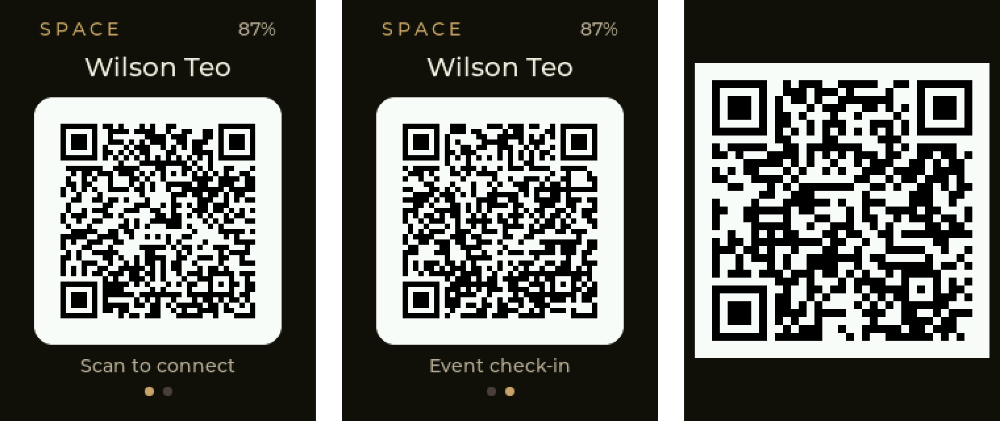
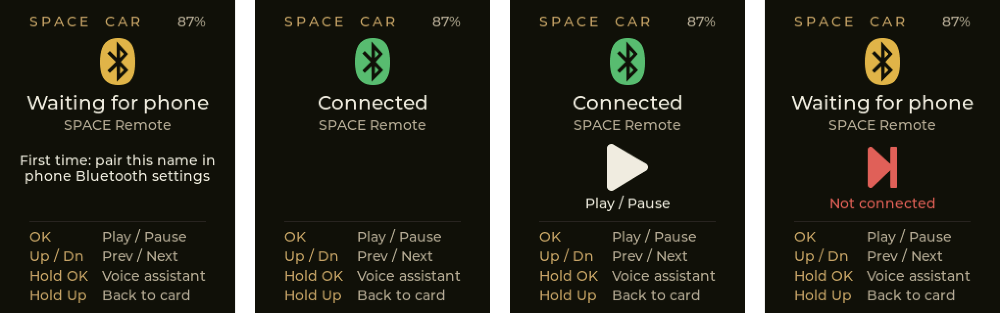

# SPACE 名片 · FoloToy AI Passport 小应用

FoloToy AI Passport（ESP32-C3、240×320 屏幕、三个按键）有两个模式：

- **名片模式**（预设）：显示**你的 SPACE 名片二维码**。活动上把它拿出来：对方手机一扫 → 打开 SPACE 公开名片页 → 留资料 → **自动进 SPACE**（标签「扫码」，互动记成「扫 FoloToy 留资料」）。
- **车用遥控器模式**：FoloToy 当 Android 手机的**蓝牙媒体遥控器**，手机不用装 app。开车时按 FoloToy 控制微信读书听书、音乐，长按叫语音助理。见下面「车用遥控器」。

名片画面**「下」长按** → 车用模式；车用画面**「上」长按** → 回名片。机器会记住模式，下次开机停在同一个（换模式会重开机，约 2 秒）。

上游韧体：[FoloToy/ai-passport](https://github.com/FoloToy/ai-passport)（MIT，ESP-IDF 5.5.3 + LVGL 9.5）。
这个资料夹不是完整韧体，是放进上游 fork 的 `main/`（取代原本的测试菜单）。已经编好的韧体在 `firmware/`。

## 最简单：网页烧录（不用装任何东西，约 5 分钟）

要：一台电脑（Windows / Mac）的 **Chrome 或 Edge**，一条**能传资料**的 USB-C 线（只能充电的线不行）。

1. 下载 [`firmware/SPACE-card-full.bin`](./firmware/SPACE-card-full.bin)（GitHub 上打开 → 右上角下载）
2. FoloToy 开机，用 USB 线接电脑；Chrome 打开 FoloToy 官方的**在线刷机工具**：`https://ai-passport.folotoy.cn/tools/web-flasher/`
3. 连接设备（浏览器会跳出 USB 装置清单，选 FoloToy / USB JTAG）→ 选刚下载的 `SPACE-card-full.bin` → 波特率 **460800** → 开始写入
4. 写完重开机 → 屏幕显示你的名片二维码。用 iPhone 相机、Android 相机、WhatsApp 各扫一次

**想换回原本的画面**：同样步骤，改选 [`firmware/FoloToy-original-e85197d-full.bin`](./firmware/FoloToy-original-e85197d-full.bin)（官方开源版原封不动编的，上游 commit `e85197d`）。官方没有发布出厂韧体档，如果你的机器出厂装的不是开源版，这个档案会跟出厂时不完全一样。



（上图是电脑模拟的画面，三个二维码都用程序扫过、网址正确；真机颜色可能略有不同。）

**改名字 / 网址后重编**：在有 Docker 的电脑跑 `./build.sh`（不用装 ESP-IDF）→ 新的 `firmware/SPACE-card-full.bin`；`./sim/run.sh --update-screenshot` 更新上面的截图。名字、网址的预设值在 `main/Kconfig.projbuild`。

## NFC：背面直接写

FoloToy 背面就是一枚**被动 NTAG213** NFC 芯片（官方规格：支持普通 NDEF 读写），没接主板、跟韧体无关，用手机写一次就好：

- Android：SPACE「我的名片」→ NFC 贴纸分页 →「写进 NFC 贴纸」→ 手机背面贴近 FoloToy 背面
- iPhone：免费 app **NFC Tools** → 写 → 添加记录 → 网址 → `https://space-riccione-reka.vercel.app/c?s=nfc` → 写 → 贴近

写完别人手机碰一下就打开名片页，留资料会多一个「NFC」标签。写之前可以先用 NFC Tools「读取」看看，确认是 NTAG213、可写入。

## 画面和按键

```
┌──────────────────────┐
│ SPACE          87%   │  左上品牌字、右上电量（读不到就不显示）
│      Wilson Teo      │  名字
│  ┌────────────────┐  │
│  │   二维码 176px  │  │  白底 + 白边，深色背景（跟手机名片页同一套颜色）
│  └────────────────┘  │
│   Scan to connect    │  这个二维码是什么
│        ● ○           │  有「活动」二维码时的页点
└──────────────────────┘
```

| 按键 | 做什么 |
|---|---|
| 上 / 下 短按 | 切换「名片」/「活动」二维码（menuconfig 有设活动网址才有第二个） |
| 确定 短按 | 亮度 100% → 60% → 30% |
| 确定 长按 | 大二维码模式：只剩 224px 的二维码，远一点也扫得到；再长按回来 |
| 闲置 60 秒 | 自动调暗到 15%；调暗时按任何键只会叫醒，不会切换 |
| 下 长按 | 换到车用遥控器模式（重开机约 2 秒） |

二维码用 LVGL 内建的 `lv_qrcode`（qrcodegen、ECC M、整数倍放大不会糊）。网址会自动加上 `?s=folotoy`（已经有 `s=` 就不加）。

## 车用遥控器（Android，蓝牙，不用装 app）



（电脑模拟的四个状态：黄色蓝牙 = 等手机，绿色 = 可以用；中间大图示是刚按的键，红色 = 没连上没送出。）

### 第一次配对（Samsung，一次就好）

1. 名片画面按住「下」→ FoloToy 重开机进车用模式，屏幕写 **Waiting for phone**
2. 手机「设定 → 连接 → 蓝牙」→ 扫描 → 点 **SPACE Remote** → 配对（不用输入密码）
3. FoloToy 蓝牙图示变**绿色**、写 **Connected** 就好了。之后进车用模式会自动重连（最多记 3 台手机）

### 按键

| 键 | 做什么 |
|---|---|
| 确定 短按 | 播放 / 暂停（手机上**正在播或最后播**的那个：微信读书听书、Spotify、YouTube……） |
| 上 / 下 短按 | 上一段 / 下一段（微信读书里是上一章 / 下一章还是快退快进，要实测） |
| 确定 长按 | 叫出语音助理：说「用 WhatsApp 打给 Ah Meng」「打开微信读书」 |
| 上 长按 | 回名片模式 |
| 闲置 60 秒 | 调暗到 10%；**调暗时按键照样有效**（开车不用先按一下叫醒） |

### 要先知道的

- **语音助理**：Samsung 预设可能叫出 Bixby。要用 Google 助理：「设定 → 应用程式 → 选择预设应用程式 → 数位助理应用程式 → Google」。
- **微信读书**：要先在手机上开始听书一次，播放键才控制得到它；开微信读书、切回导航这些要等第二阶段的 Android app。
- **麦克风**：FoloToy 只有低功耗蓝牙，**不能当手机的通话麦克风**。打电话、语音助理听的是车上蓝牙或手机的麦克风。
- 开车请把 FoloToy 固定好（出风口夹、方向盘旁），不要拿在手上按。

## 自己装 ESP-IDF 编译（开发者用；一般用上面的网页烧录就好）

1. **Fork 上游**：GitHub 打开 `FoloToy/ai-passport` → Fork → 开一个分支 `space-card`。照上游 `docs/development/engineering/environment-setup.md` 装好 **ESP-IDF 5.5.3**。
2. **放进这些档案**（覆盖同名的）：
   ```
   network/folotoy/main/main.c               → <fork>/main/main.c
   network/folotoy/main/CMakeLists.txt       → <fork>/main/CMakeLists.txt
   network/folotoy/main/Kconfig.projbuild    → <fork>/main/Kconfig.projbuild
   network/folotoy/main/space_card.c / .h    → <fork>/main/
   network/folotoy/main/space_card_model.c / .h → <fork>/main/
   network/folotoy/main/car_remote_model.c / .h、car_screen.c / .h、ble_remote.c / .h → <fork>/main/
   network/folotoy/tests/test_*.c            → <fork>/tests/
   ```
   上游的 `main/key_guard.h` **留着**（按键唤醒的保护，新的 `main.c` 有用到）。`demo_*.c`、`ui_pixel*` 可以留在资料夹里（不会被编进韧体，上游的 host 测试还会用到）。
3. **设定**：把 `network/folotoy/sdkconfig.space.defaults` 的内容接在 `<fork>/sdkconfig.defaults` 最后面（打开 `lv_qrcode`、48px 字型、车用遥控器的 NimBLE HID 服务和配对资料储存）。
   在 `<fork>/tools/validate.sh` 的 host 测试那段加一行（照旁边的写法）：
   ```bash
   cc ... -Imain tests/test_space_card_model.c main/space_card_model.c -o "${test_dir}/test_space_card_model"
   "${test_dir}/test_space_card_model"
   ```
4. **填你的网址**：
   ```bash
   idf.py set-target esp32c3
   idf.py menuconfig        # → SPACE card
   ```
   - `Card link`：SPACE →「我的名片」→ FoloToy 分页 → 复制（例：`https://space-riccione-reka.vercel.app/c`）
   - `Name at the top`：英文名（预设字型 Montserrat 没有中文，中文会变成 `?`）
   - 选填 `Event link`：「活动模式」某个活动的二维码连结（上下键切换）
5. **编译、烧录**：
   ```bash
   ./tools/validate.sh --static     # host 测试（含 test_space_card_model）
   idf.py build
   idf.py -p /dev/ttyACM0 flash monitor   # Mac：/dev/cu.usbmodem*；Windows：COM3 之类
   ```
   开机 log 会印出 `二维码 1：https://…/c?s=folotoy`。
6. **验收**：用 iPhone 相机、Android 相机、WhatsApp 内建扫码各扫一次 → 打开的是你的名片页 → 留一笔假资料 → SPACE「人脉」顶部出现「新朋友 1」，标签「扫码」、互动「扫 FoloToy 留资料」。

换网址 / 换活动：改 menuconfig 再烧一次（第一版没做 Wi-Fi 同步，见下面「以后可以加」）。

## 结构

| 档案 | 内容 |
|---|---|
| `main/space_card_model.c/.h` | 纯逻辑：网址加 `s=folotoy`、按键 → 状态、闲置调暗、亮度、二维码大小 / 版本估算、电量文字（**有 host 测试**） |
| `main/space_card.c/.h` | LVGL 画面：深色底、品牌字、电量、名字、白底二维码、说明、页点；大二维码模式 |
| `main/car_remote_model.c/.h` | 车用遥控器纯逻辑：换模式、按键 → 动作 → HID 用法码（播放 0xCD、下一首 0xB5、上一首 0xB6、语音 0xCF）、报告格式、调暗、画面文字（**有 host 测试**） |
| `main/ble_remote.c/.h` | 蓝牙：ESP-IDF `esp_hid`（NimBLE）建 HID / 电量 / 装置资讯服务；广播「SPACE Remote」、Just Works 配对 + 绑定、断线重新广播、送媒体键 |
| `main/car_screen.c/.h` | 车用画面：蓝牙图示（颜色 = 状态）、状态大字、刚按的动作、按键说明 |
| `main/main.c` | 开机：NVS（模式 + 配对资料）→ BSP 初始化 → 依模式开名片或车用画面 → 按键（回呼只丢 queue，input task 拿 LVGL 锁再改画面；沿用上游的按键唤醒保护） |
| `main/Kconfig.projbuild` | menuconfig 的「SPACE card」：网址、名字、说明字、活动网址、遥控器蓝牙名字 |
| `tests/test_*.c` | host 测试（名片、车用遥控器）：指令写在各档案开头；`build.sh` 每次都跑 |
| `build.sh` | 一键编韧体：取上游（固定 commit）+ 叠上 `main/` + 依赖照 `dependencies.lock` 从 git 取 → Docker `espressif/idf:v5.5.3` 里 host 测试、编译、merge-bin、上游 `verify_firmware.py`；`--original` 编官方原版 |
| `sim/` | 电脑模拟屏幕：真的 LVGL 9.5 + `space_card.c`、`car_screen.c`，假的电量 / 背光 / 时间 / 蓝牙（`sim/stub/`）→ 画面 PNG，名片的二维码用 OpenCV 扫过比对网址（`sim/run.sh`） |
| `firmware/` | 编好的韧体（名片、官方原版）、`SHA256SUMS.txt`、模拟截图 |

照上游规则：衍生 app 用自己的画面（没有沿用测试菜单 / `ui_pixel` 外壳），只重用 BSP 和 `key_guard.h`；LVGL 只在持锁时碰；按键回呼不阻塞；送蓝牙按键时不持 LVGL 锁；电量放右上角、读不到就不显示；只用 ASCII 字（没有中文字型问题）。

## 验证状态（诚实版）

```text
Build:        PASS      —— 2026-11-18：./build.sh（ESP-IDF 5.5.3 Docker、esp32c3）编译通过，main/ 没有警告；
                           上游 verify_firmware.py：Firmware layout PASS、Merged firmware PASS（1,174,496 bytes，烧在 0x0）
                           静态 DRAM 112 KB / 剩 209 KB 给 heap（蓝牙只在车用模式启动）
Host tests:   PASS      —— test_space_card_model、test_car_remote_model（-Wall -Wextra -Werror）
Simulated:    PASS      —— sim/run.sh：名片 / 活动 / 大二维码三个画面，OpenCV 都扫出正确网址（带 s=folotoy）；
                           车用四个状态画面看过（等配对、已连线、刚按播放、没连上）
Device tests: NOT RUN   —— 还没在真机上烧过
Unverified:   真机画面（颜色、圆角）、手机对着这块屏幕实际扫码、背光实际亮度、电量读数、按键手感；
              车用：Samsung 配对与自动重连、播放 / 上下一首在微信读书 / Spotify 的效果、
              「语音助理」键（Consumer 0xCF → Android VOICE_ASSIST）在 One UI 叫出哪个助理、蓝牙执行时的记忆体
```

依赖是照上游 `dependencies.lock` 的版本从各自的 git 取的（开发环境连不上 Espressif 组件仓库），内容应该相同，但组件仓库的 hash 没有逐一比对过。

## 以后可以加

接下来的路线（2026-11-18 定）见 `../PLAN.md`「FoloToy 口袋机」：菜单 + 木鱼 / 手电筒 / 番茄钟 + 叠叠乐 / 记忆三色 / 求签抽奖（中文画面），之后再做 Wi-Fi：今日星座、新闻（Grok 每天寄的新闻信）、读书。

- **Wi-Fi 同步**：开机连 Wi-Fi 读 `/api/card` 拿最新的活动网址，不用重烧（要做 Wi-Fi 设定页，上游有 BluFi 配网可以参考）
- 中文名字：要加中文字型子集（上游 `docs/development/engineering/lvgl-chinese-fonts.md`）
