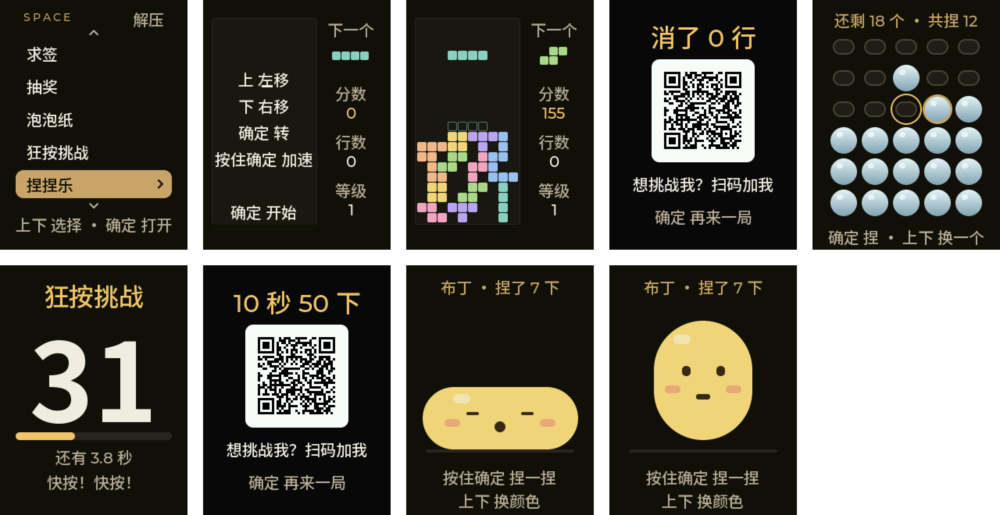
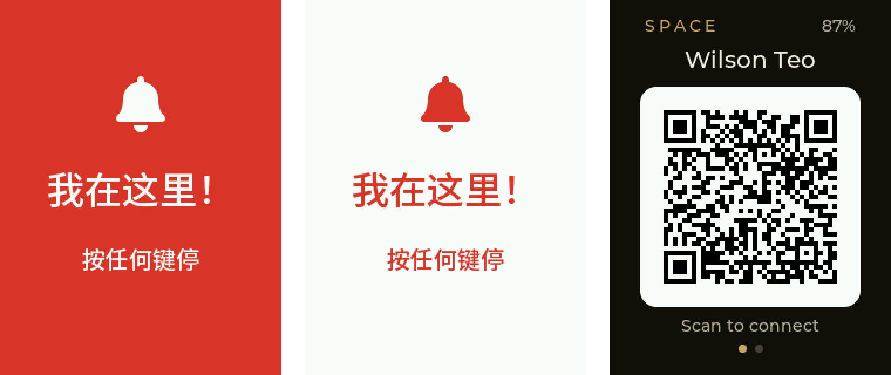
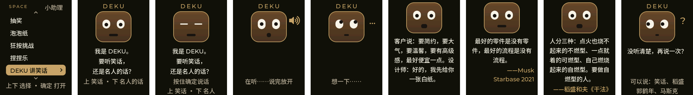

# SPACE 名片 · FoloToy AI Passport 小应用

FoloToy AI Passport（ESP32-C3、240×320 屏幕、三个按键）有两个模式：

- **开机封面**：深色木纹 + 官方 RICCIONE® / 溪岸 sAil by Riccione Reka 白色字标，一道光扫过；**按「确定」→ 名片二维码**，二维码闲置 30 秒回封面。

  

- **名片模式**（预设）：显示**你的 SPACE 名片二维码**。活动上把它拿出来：对方手机一扫 → 打开 SPACE 公开名片页 → 留资料 → **自动进 SPACE**（标签「扫码」，互动记成「扫 FoloToy 留资料」）。
- **口袋机菜单**：名片画面**「上」长按**打开菜单（可以卷动）：
  - 工具：**蜡烛与生日歌**、**木鱼**、**手电筒**、**计时器**、**倒数计时**、**番茄钟**
  - 游戏：**叠叠乐**、**落落方块**、**记忆三色**、**求签**、**抽奖**
  - 解压：**泡泡纸**、**狂按挑战**、**捏捏乐**
  - 小助理：**DEKU 讲笑话**（笑话、稻盛和夫 / 郭鹤年 / Musk 的原话；见下面「DEKU 小助理」）
  - 车用遥控器、返回名片
  - 见下面「口袋机」
- **车用遥控器模式**：FoloToy 当 Android 手机的**蓝牙媒体遥控器**，手机不用装 app。开车时按 FoloToy 控制微信读书听书、音乐，长按叫语音助理。见下面「车用遥控器」。
- **手机找 FoloToy**：手机「SPACE 车控」app 按「让 FoloToy 响」→ FoloToy 嘀嘀响、屏幕红白闪（任何模式、任何画面都会）；app 还记得它最后跟手机断线的时间和地点、忘了带会提醒。见下面「手机找 FoloToy」。

名片画面**「下」长按**（或菜单里选「车用遥控器」）→ 车用模式；车用画面**「上」长按** → 回名片。机器会记住模式，下次开机停在同一个（换模式会重开机，约 2 秒）。菜单里的其他功能不用重开机。

上游韧体：[FoloToy/ai-passport](https://github.com/FoloToy/ai-passport)（MIT，ESP-IDF 5.5.3 + LVGL 9.5）。
这个资料夹不是完整韧体，是放进上游 fork 的 `main/`（取代原本的测试菜单）。已经编好的韧体在 `firmware/`。

## 最简单：网页烧录（不用装任何东西，约 5 分钟）

要：一台电脑（Windows / Mac）的 **Chrome 或 Edge**，一条**能传资料**的 USB-C 线（只能充电的线不行）。

1. 下载 [`firmware/SPACE-card-full.bin`](./firmware/SPACE-card-full.bin)（GitHub 上打开 → 右上角下载）
2. FoloToy 开机，用 USB 线接电脑；Chrome 打开 FoloToy 官方的**在线刷机工具**：`https://ai-passport.folotoy.cn/tools/web-flasher/`
3. 连接设备（浏览器会跳出 USB 装置清单，选 FoloToy / USB JTAG）→ 选刚下载的 `SPACE-card-full.bin` → 波特率 **460800** → 开始写入
4. 写完重开机 → 屏幕显示你的名片二维码。用 iPhone 相机、Android 相机、WhatsApp 各扫一次

**想换回原本的画面**：同样步骤，改选 [`firmware/FoloToy-original-e85197d-full.bin`](./firmware/FoloToy-original-e85197d-full.bin)（官方开源版原封不动编的，上游 commit `e85197d`）。官方没有发布出厂韧体档，如果你的机器出厂装的不是开源版，这个档案会跟出厂时不完全一样。


（上图是电脑模拟的画面，三个二维码都用程序扫过、网址正确；真机颜色可能略有不同。）

**改名字 / 网址后重编**：在有 Docker 的电脑跑 `./build.sh`（不用装 ESP-IDF）→ 新的 `firmware/SPACE-card-full.bin`；`./sim/run.sh --update-screenshot` 更新上面的截图。名字、网址的预设值在 `main/Kconfig.projbuild`。

## NFC：背面直接写

FoloToy 背面就是一枚**被动 NTAG213** NFC 芯片（官方规格：支持普通 NDEF 读写），没接主板、跟韧体无关，用手机写一次就好：

- Android：SPACE「我的名片」→ NFC 贴纸分页 →「写进 NFC 贴纸」→ 手机背面贴近 FoloToy 背面
- iPhone：免费 app **NFC Tools** → 写 → 添加记录 → 网址 → `https://space-riccione-reka.vercel.app/c?s=nfc` → 写 → 贴近

写完别人手机碰一下就打开名片页，留资料会多一个「NFC」标签。写之前可以先用 NFC Tools「读取」看看，确认是 NTAG213、可写入。

## 画面和按键

```
┌──────────────────────┐
│ SPACE          87%   │  左上品牌字、右上电量（读不到就不显示）
│      Wilson Teo      │  名字
│  ┌────────────────┐  │
│  │   二维码 176px  │  │  白底 + 白边，深色背景（跟手机名片页同一套颜色）
│  └────────────────┘  │
│   Scan to connect    │  这个二维码是什么
│        ● ○           │  有「活动」二维码时的页点
└──────────────────────┘
```

| 按键 | 做什么 |
|---|---|
| 确定 短按（封面时） | 显示名片二维码（闲置 30 秒自动回封面） |
| 上 / 下 短按 | 切换「名片」/「活动」二维码（menuconfig 有设活动网址才有第二个） |
| 确定 短按 | 亮度 100% → 60% → 30% |
| 确定 长按 | 大二维码模式：只剩 224px 的二维码，远一点也扫得到；再长按回来 |
| 闲置 60 秒 | 自动调暗到 15%；调暗时按任何键只会叫醒，不会切换 |
| 下 长按 | 换到车用遥控器模式（重开机约 2 秒） |

二维码用 LVGL 内建的 `lv_qrcode`（qrcodegen、ECC M、整数倍放大不会糊）。网址会自动加上 `?s=folotoy`（已经有 `s=` 就不加）。

## 口袋机：蜡烛与生日歌、计时器、倒数


名片画面按住「上」→ 菜单（上下选、确定打开）。每个功能里**按住「上」回菜单**。

### 蜡烛与生日歌

生日蛋糕没有蜡烛也能吹：屏幕上是**数字蜡烛**（年龄），火苗会晃，关灯时很有气氛。

| 键 | 做什么 |
|---|---|
| 上 / 下 短按 | 年龄 +1 / −1（0–99，预设 18） |
| 确定 短按 | 放「祝你生日快乐」，屏幕跟着显示**华语**歌词 |
| 下 长按 | 放「Happy Birthday」，屏幕跟着显示**英语**歌词 |
| 唱歌时按任何键 | 停 |
| **对着 FoloToy 吹一口气** | 蜡烛熄灭、冒烟、出现「生日快乐！」 |
| 确定 长按 | 用按键熄灭（太吵、吹不熄时用） |
| 熄了之后 确定 | 重新点燃 |

- 歌是 FoloToy 喇叭自己合成的**旋律**（像音乐盒），没有人声，所以华语和英语的旋律一样，差别在屏幕上的歌词。这首歌的旋律和歌词都已经是公有领域。
- **唱歌时不会被吹熄**（麦克风会听到歌声），唱完 1 秒后才开始听吹气。有人吹时火苗会往旁边倒。
- 吹气的判断：要**够大声、持续约 0.1 秒以上、而且像气流的沙沙声**。拍桌、咳一声、大声说话唱歌都不会误熄（电脑测试有测这几种）。门槛要等真机测过再调。
- 蜡烛画面一直全亮、不会自动变暗。

### 木鱼 / 手电筒 / 番茄钟

| 功能 | 键 |
|---|---|
| 木鱼 | 确定 = 敲一下（「咚」+「功德 +1」飘上去）；上 / 下 = 自动敲（每秒一下）开 / 关；功德存在机器里，关机还在 |
| 手电筒 | 上 / 下 = 白光 → 暖光 → 红光（夜里不刺眼）；一直全亮 |
| 番茄钟 | 专注 25 分 / 休息 5 分轮替；确定 = 开始 / 暂停，确定 长按 = 这一段重来；时间到红白闪 + 嘀嘀嘀，按任何键停、马上开始下一段 |

### 小游戏

| 游戏 | 怎么玩 |
|---|---|
| 叠叠乐 | 方块左右滑，确定放下；没对齐的部分切掉，越叠越快。完全对齐有「叮」 |
| 记忆三色 | 三个圆（上 蓝 / 下 黄 / 确定 红）照顺序亮 + 出声，照着按回去；对了多一个再来 |
| 求签 | 确定（或按住）摇签，掉出一支：上上签 / 上签 / 中签 + 两句话；抽过的先不重复 |
| 抽奖 | 确定 → 像拉霸一样跳，越跳越慢停在抽中的奖项 |
| 落落方块 | 10×20 格、七种四格方块往下掉，排满一行就消掉，每 10 行升一级变快。**上 左移、下 右移**（按住连续移）、**确定 点一下转**、**确定 按住加速往下掉**（落地就停，要再按住）；有虚影显示会落在哪。**上 长按 = 暂停**，暂停时再长按回菜单 |

### 解压

| 功能 | 怎么玩 |
|---|---|
| 泡泡纸 | 5×6 个泡泡，**确定 一下捏破一个**（哒 + 一圈金光），自动跳到下一个；上 / 下 选别的。全部捏完 → 确定 换一张新的；上面显示这次一共捏了几个 |
| 狂按挑战 | 第一下开始算，**10 秒内三个键随便按，越多越好**；结束显示「10 秒 N 下」+ 名片二维码。结束后 1.5 秒内的按键不算（免得一不小心就重开），确定 再来；记这次开机的最高纪录 |
| 捏捏乐 | 一颗软团子：**确定 按住** 慢慢压扁、眯眼、嘴巴变 O；**放开** 像软糖一样弹起来晃几下。上 / 下 换颜色（桃桃 / 布丁 / 抹茶），上面记捏了几下 |



- 落落方块、泡泡纸、狂按挑战、捏捏乐用「按下 / 放开」那一下（不等单击判定），反应快、连按不会被并成一次

- 叠叠乐、记忆三色、落落方块、狂按挑战结束时：分数 + **名片二维码「想挑战我？扫码加我」**（扫进来记成扫 FoloToy）
- **求签签文是草稿**（24 支，自己写的吉祥话，不是传统观音灵签原文）：在 `main/games_model.c` 的 `FORTUNE_TEXT`，要审过定稿
- **抽奖奖项是占位**（一等奖 1 : 二等奖 3 : 三等奖 6 : 谢谢参与 10）：给真的奖项和比例再改 `PRIZE` / `WEIGHT`

### 计时器 / 倒数计时

| 画面 | 键 | 做什么 |
|---|---|---|
| 计时器 | 确定 | 开始 / 暂停 |
| 计时器 | 下（暂停时） | 归零 |
| 倒数 | 上 / 下（设定时） | ±1 分钟（1–99 分，预设 5 分） |
| 倒数 | 确定 | 开始 / 暂停 / 继续 |
| 倒数 | 确定 长按 | 归零回设定 |
| 倒数时间到 | 任何键 | 停铃（画面红白闪 + 嘀嘀嘀） |

离开画面再回来，时间照算；但倒数要**停在倒数画面**才会响铃。

## 车用遥控器（Android，蓝牙，不用装 app）


（电脑模拟的四个状态：黄色蓝牙 = 等手机，绿色 = 可以用；中间大图示是刚按的键，红色 = 没连上没送出。）

### 第一次配对（Samsung，一次就好）

1. 名片画面按住「下」→ FoloToy 重开机进车用模式，屏幕写 **Waiting for phone**
2. 手机「设定 → 连接 → 蓝牙」→ 扫描 → 点 **SPACE Remote** → 配对（不用输入密码）
3. FoloToy 蓝牙图示变**绿色**、写 **Connected** 就好了。之后 FoloToy 开着（任何模式）手机就会自动重连（最多记 3 台手机）；**新手机只能在车用模式配对**

### 按键

| 键 | 做什么 |
|---|---|
| 确定 短按 | 播放 / 暂停（手机上**正在播或最后播**的那个：微信读书听书、Spotify、YouTube……） |
| 上 / 下 短按 | 上一段 / 下一段（微信读书里是上一章 / 下一章还是快退快进，要实测） |
| 确定 长按 | 叫出语音助理：说「用 WhatsApp 打给 Ah Meng」「打开微信读书」 |
| 上 长按 | 回名片模式 |
| 闲置 60 秒 | 调暗到 10%；**调暗时按键照样有效**（开车不用先按一下叫醒） |

### 要先知道的

- **语音助理**：Samsung 预设可能叫出 Bixby。要用 Google 助理：「设定 → 应用程式 → 选择预设应用程式 → 数位助理应用程式 → Google」。
- **微信读书**：要先在手机上开始听书一次，播放键才控制得到它；开微信读书、切回导航这些要等第二阶段的 Android app。
- **麦克风**：FoloToy 只有低功耗蓝牙，**不能当手机的通话麦克风**。打电话、语音助理听的是车上蓝牙或手机的麦克风。
- 开车请把 FoloToy 固定好（出风口夹、方向盘旁），不要拿在手上按。

## 手机找 FoloToy（v0.2，2026-11-18）



要：FoloToy 烧最新的 `SPACE-card-full.bin`、手机装最新的 [`SPACE-car-app.apk`](./firmware/SPACE-car-app.apk)（v0.2，直接覆盖安装）、手机跟 FoloToy 配对过（见下面「车用遥控器 → 第一次配对」）。

### 用法

打开「SPACE 车控」app，最上面就是「找 FoloToy」：

| 你做 | 会怎样 |
|---|---|
| 按「让 FoloToy 响」 | FoloToy 嘀嘀响 + 屏幕红白闪「我在这里！」+ 全亮。app 显示信号格（▮▮▮▯▯）和「越来越近 / 越来越远」 |
| 在 FoloToy 上按**任何一个键** | 停；app 显示「找到了 ✓」。这一下只用来停，不会让 FoloToy 跳画面 |
| 没人按 | 响 30 秒自己停 |
| 按「停」 | 从手机叫停 |
| FoloToy 现在没连上 | app 先连它（最多等 30 秒），连上马上响；连不上就看「最后在哪里」 |

- **最后在哪里**：FoloToy 跟手机断线时，app 记下时间和手机那时的位置，显示「昨天 21:12 跟手机断线」+「在地图上看最后的位置」（Google Maps）。只存在这支手机里，不上网。
- **忘了带提醒**（可以关）：断线约 45 秒还没连回来 → 手机震 + 通知「FoloToy 没跟着你？」。FoloToy 换模式重开机几秒就连回来，不会吵；手机蓝牙关掉时不提醒。
- 第一次用：app 里按「④ 位置、通知」→ 允许 → **再按一次 ④ → 位置选「一律允许」**（断线时 app 多半在背景，没有「一律允许」就只记时间、不记位置）。

### 蓝牙怎么开（2026-11-18 用户选「C」）

| 模式 | 蓝牙 |
|---|---|
| 车用遥控器 | 照旧：快速广播、手机设定里看得到、可以配对新手机 |
| 名片 / 口袋机 | **约每秒广播一次**；手机设定里看不到它；**只让配对过的手机连**（活动上别人的手机连不上、也没办法叫它响）。连上后请手机放慢连线（约 0.3 秒一次），所以从按「找」到响最多 1 秒左右；没连着时手机要先找到它，通常几秒 |

- **新手机要在车用模式配对**（名片模式不接受新配对）。
- 耗电：FoloToy 的屏幕和处理器本来就一直开着（只会调暗），低频蓝牙多耗的电跟屏幕比很小；实际待机时间要真机量。
- **关机时找不到**：任何做法都要 FoloToy 开着。没电、关机时就看「最后在哪里」。
- 一次只能连一支手机（跟车用模式一样）。

## DEKU 小助理（v0.4，2026-11-18）



口袋机菜单 →「DEKU 讲笑话」。DEKU 是一块原创的小木块（跟开机封面同一种木色），会眨眼、听、想、说。

| 键 | 做什么 |
|---|---|
| 确定 **按住** | 对它说话：「讲个笑话」「稻盛和夫」「郭鹤年」「马斯克」「名言」「再来一个」。放开后**手机念出来**，FoloToy 显示同一句和出处（要开 SPACE 车控 app v0.3） |
| 上 短按 | 直接来一个笑话 |
| 下 短按 | 直接来一句名人的话（稻盛和夫 → 郭鹤年 → Musk 轮流） |
| 上 长按 | 回菜单 |

- 听话用手机内建的语音转文字（Android，免费），再用**关键词**挑句子：**不用 AI、不花钱**。听不懂会说「你可以说：讲个笑话、稻盛和夫……」。
- Musk 的话：先念中文翻译，再念英文原句（英文原句才是他说的话）。
- 没开 app 时，上 / 下 / 确定照样有句子，只是没有声音。
- 句子一轮里不重复。
- 说话时脸往上移，留整块地方给句子；中文断行照排版规矩（「，。」不放行首、书名不从中间切）。

### 句库：审过才放（AI 只能建议、不能编）

- 句库在 `deku/lines.json`：笑话是 Claude 写的原创；名人的话是 Claude 起草的候选，**都附出处和把握（高 / 中 / 低）**。
- **每一句都要用户审过（`status: approved`）才会放进 FoloToy 和手机**。2026-11-18 用户审过 73 句，全部「要」：笑话 36、稻盛和夫 22、郭鹤年 3、Musk 12。
- 审核网页：https://claude.ai/artifact/4DcXNNxeknMGqygntM4W6V（每句选「要 / 不要」→「复制结果」贴回给 Claude）。郭鹤年只找到二手报道，建议对过《郭鹤年自传》再勾。
- 审好之后（给开发者）：改 `lines.json` 的 `status` → `python3 tools/make_deku.py`（产生 `main/deku_lines.c`、app 的 `assets/deku.json`）→ `tools/make_font.py`（新的中文字）→ `./build.sh`、`./android/build.sh`。

## SPACE 车控 Android app（第二阶段，v0.4）

装了 app 之后，FoloToy 车用模式多两个功能（没装 app 时照旧是媒体遥控器）：

| 键 | 做什么 |
|---|---|
| **按住「下」** | 打开微信读书 →「继续上次那本」→ 3 秒不按就自动开始播 → 2 秒后切回刚才的 Waze / Google Maps |
| **按住「确定」** | 常联络清单：手机念名字、FoloToy 显示「2 / 5 Ah Meng」；上下选 |
| 清单里 确定 | **WhatsApp 语音通话**（用通讯录里 WhatsApp 的通话项目直接拨） |
| 清单里 按住确定 | **录 WhatsApp 语音讯息**：打开对话、帮你按住录音键，放开 FoloToy 的键就送出（最长 60 秒） |
| 清单里 按住「上」 | 取消（15 秒没动作也会自动取消） |

### 安装（Samsung）

1. 下载 [`firmware/SPACE-car-app.apk`](./firmware/SPACE-car-app.apk) 到手机 → 点开安装（第一次会问「允许安装未知应用程式」→ 允许）
2. FoloToy 也要烧最新的 `SPACE-card-full.bin`（有 SPACE 车控通道）
3. 打开「SPACE 车控」app，照顺序按：
   - ① 开权限（附近的装置、通讯录）
   - ② 开无障碍服务：设定 → 协助工具 → 已安装的应用程式 → SPACE 车控 → 开启
   - ③ 电池：允许不受限制；Samsung 再到「设定 → 电池 → 背景使用限制 → 永不休眠的应用程式」加入 SPACE 车控
   - ④ 位置、通知（找 FoloToy 的「最后在哪里」「忘了带提醒」用）：按两次，第二次位置选「一律允许」
4. 「＋ 加朋友」从通讯录选几个常联络的人，填 FoloToy 上显示的英文名（FoloToy 只有英文字型；中文名字手机会念）
5. app 上方状态写「FoloToy 已连线 ✓」、FoloToy 画面写「SPACE Remote + App」就好了

### 怎么做到的、限制

- 全部在一个 Android「无障碍服务」里：它能在背景打开别的 app（一般 app 在 Android 10 以后不行）、帮你按按钮。只在你按 FoloToy 时动作，不读讯息内容、不上网。
- 微信读书：找画面上的「21:04 / 64:02」→ 按旁边的 ▶；在完整播放器就按中间的大 ▶；都找不到就送「播放」键。按钮位置照 2026-11-18 的截图写，微信读书改版可能要调。
- **要是按不到**：app 里「5 秒后抓画面结构」→ 切到微信读书 → 回 app 按「分享」传给 Claude，就能对准。
- WhatsApp 录音键也是找画面上的按钮（`voice_note_btn`）；WhatsApp 改版可能要调。
- 还没做：上下选「最近读的书」（要先用诊断看清楚书单的结构）、微信语音。
- 签名是固定的 debug key（`android/debug.keystore`，Android 标准 debug 帐密），新版可以直接覆盖安装；不是上架用的。
- 编译：`./android/build.sh`（Docker `cimg/android`，会跑 17 个单元测试）

## 自己装 ESP-IDF 编译（开发者用；一般用上面的网页烧录就好）

1. **Fork 上游**：GitHub 打开 `FoloToy/ai-passport` → Fork → 开一个分支 `space-card`。照上游 `docs/development/engineering/environment-setup.md` 装好 **ESP-IDF 5.5.3**。
2. **放进这些档案**（覆盖同名的）：
   ```
   network/folotoy/main/main.c               → <fork>/main/main.c
   network/folotoy/main/CMakeLists.txt       → <fork>/main/CMakeLists.txt
   network/folotoy/main/Kconfig.projbuild    → <fork>/main/Kconfig.projbuild
   network/folotoy/main/space_card.c / .h    → <fork>/main/
   network/folotoy/main/space_card_model.c / .h → <fork>/main/
   network/folotoy/main/car_remote_model.c / .h、car_screen.c / .h、ble_remote.c / .h → <fork>/main/
   network/folotoy/tests/test_*.c            → <fork>/tests/
   ```
   上游的 `main/key_guard.h` **留着**（按键唤醒的保护，新的 `main.c` 有用到）。`demo_*.c`、`ui_pixel*` 可以留在资料夹里（不会被编进韧体，上游的 host 测试还会用到）。
3. **设定**：把 `network/folotoy/sdkconfig.space.defaults` 的内容接在 `<fork>/sdkconfig.defaults` 最后面（打开 `lv_qrcode`、48px 字型、车用遥控器的 NimBLE HID 服务和配对资料储存）。
   在 `<fork>/tools/validate.sh` 的 host 测试那段加一行（照旁边的写法）：
   ```bash
   cc ... -Imain tests/test_space_card_model.c main/space_card_model.c -o "${test_dir}/test_space_card_model"
   "${test_dir}/test_space_card_model"
   ```
4. **填你的网址**：
   ```bash
   idf.py set-target esp32c3
   idf.py menuconfig        # → SPACE card
   ```
   - `Card link`：SPACE →「我的名片」→ FoloToy 分页 → 复制（例：`https://space-riccione-reka.vercel.app/c`）
   - `Name at the top`：英文名（预设字型 Montserrat 没有中文，中文会变成 `?`）
   - 选填 `Event link`：「活动模式」某个活动的二维码连结（上下键切换）
5. **编译、烧录**：
   ```bash
   ./tools/validate.sh --static     # host 测试（含 test_space_card_model）
   idf.py build
   idf.py -p /dev/ttyACM0 flash monitor   # Mac：/dev/cu.usbmodem*；Windows：COM3 之类
   ```
   开机 log 会印出 `二维码 1：https://…/c?s=folotoy`。
6. **验收**：用 iPhone 相机、Android 相机、WhatsApp 内建扫码各扫一次 → 打开的是你的名片页 → 留一笔假资料 → SPACE「人脉」顶部出现「新朋友 1」，标签「扫码」、互动「扫 FoloToy 留资料」。

换网址 / 换活动：改 menuconfig 再烧一次（第一版没做 Wi-Fi 同步，见下面「以后可以加」）。

## 结构

| 档案 | 内容 |
|---|---|
| `main/space_card_model.c/.h` | 纯逻辑：网址加 `s=folotoy`、按键 → 状态、闲置调暗、亮度、二维码大小 / 版本估算、电量文字（**有 host 测试**） |
| `main/space_card.c/.h` | LVGL 画面：深色底、品牌字、电量、名字、白底二维码、说明、页点；大二维码模式 |
| `main/car_remote_model.c/.h` | 车用遥控器纯逻辑：换模式、按键 → 动作 → HID 用法码（播放 0xCD、下一首 0xB5、上一首 0xB6、语音 0xCF）、报告格式、调暗、画面文字（**有 host 测试**） |
| `main/ble_remote.c/.h` | 蓝牙：ESP-IDF `esp_hid`（NimBLE）建 HID / 电量 / 装置资讯服务 + SPACE 车控通道；车用模式快速广播、可配对；名片 / 口袋机低频广播、只认配对过的手机、请手机放慢连线；送媒体键、收「找」的指令 |
| `main/car_screen.c/.h` | 车用画面：蓝牙图示（颜色 = 状态）、状态大字、刚按的动作、按键说明 |
| `main/find_model.c/.h` | 手机找 FoloToy 纯逻辑：指令 / 通知封包、30 秒自己停、红白闪节奏、按键停了之后把那一下吃掉（**有 host 测试**） |
| `main/find_screen.c/.h` | 「我在这里！」红白闪画面：盖在 LVGL top layer，底下的画面不受影响 |
| `main/deku_model.c/.h` | DEKU 纯逻辑：表情状态、按键、一轮不重复的抽句、名人轮流、跟 app 的封包（用句子 id 对）、逾时（**有 host 测试**） |
| `main/deku_screen.c/.h` | DEKU 画面：原创小木块脸（眨眼、在听、想、说、没听懂）+ 句子 + 出处 |
| `deku/lines.json`、`tools/make_deku.py`、`main/deku_lines.c` | DEKU 句库（草稿 / 审过 / 不要）→ 只把审过的产生成韧体的表和 app 的 `assets/deku.json`；`--check` 由 `build.sh` 检查 |
| `tools/make_deku_review.py` | 句库 → 审核网页（要 / 不要、复制结果） |
| `main/pocket_model.c/.h` | 口袋机纯逻辑：菜单、蜡烛（年龄、唱歌、熄灭）、计时器、倒数、时间文字（**有 host 测试**） |
| `main/audio_dsp.c/.h` | 生日歌旋律与歌词、音色合成（整数正弦表 + 泛音 + 包络）、吹气判断（大声 + 持续 + 沙沙感 / 爆音）（**有 host 测试**） |
| `main/sound.c/.h` | 喇叭 / 麦克风背景 task：放歌、响铃、听吹气；画面只送命令、读状态 |
| `main/games_model.c/.h` | 小游戏纯逻辑：叠叠乐（切块、变快）、记忆三色（出题、判对错）、求签（洗牌不重复）、抽奖（按比例）、落落方块（碰撞、靠墙转、消行、升级）、泡泡纸、狂按挑战（计时、冷却）、捏捏乐（弹簧）（**有 host 测试**） |
| `main/tools_screen.c`、`games_screen.c` | 木鱼 / 手电筒 / 番茄钟、四个小游戏的画面 |
| `main/menu_screen.c`、`candle_screen.c`、`timer_screen.c`、`pocket_ui.h` | 菜单、数字蜡烛（火苗动画、烟、歌词）、计时器 / 倒数（圆环、红白闪）画面 |
| `main/font_*.c` | `tools/make_font.py` 产生的字型：中文 20 / 32px（只放用到的字）、大数字 64 / 140px |
| `tools/make_cover.py`、`main/cover_img.c` | 开机封面：程序画的胡桃木纹 + 仓库里的官方白色字标（`blueprint/public/template/b/`），产生 240×320 RGB565；`--check` 由 `build.sh` 检查 |
| `tools/make_font.py` | 字型产生器：从 `main/*.c` 的字串收集中文字 → Pillow 画字 → LVGL 4bpp 格式，逐像素读回比对；`--check` 检查是不是最新（`build.sh` 每次跑） |
| `main/main.c` | 开机：NVS（模式 + 配对资料）→ BSP 初始化 → 依模式开名片或车用画面 → 按键（回呼只丢 queue，input task 拿 LVGL 锁再改画面；沿用上游的按键唤醒保护） |
| `main/Kconfig.projbuild` | menuconfig 的「SPACE card」：网址、名字、说明字、活动网址、遥控器蓝牙名字 |
| `tests/test_*.c` | host 测试（名片、车用遥控器、口袋机、生日歌 / 吹气）：指令写在各档案开头；`build.sh` 每次都跑 |
| `build.sh` | 一键编韧体：取上游（固定 commit）+ 叠上 `main/` + 依赖照 `dependencies.lock` 从 git 取 → Docker `espressif/idf:v5.5.3` 里 host 测试、编译、merge-bin、上游 `verify_firmware.py`；`--original` 编官方原版 |
| `sim/` | 电脑模拟屏幕：真的 LVGL 9.5 + `space_card.c`、`car_screen.c`，假的电量 / 背光 / 时间 / 蓝牙（`sim/stub/`）→ 画面 PNG，名片的二维码用 OpenCV 扫过比对网址（`sim/run.sh`） |
| `firmware/` | 编好的韧体（名片、官方原版）、`SHA256SUMS.txt`、模拟截图 |

**字型**：思源黑体 Noto Sans SC（Adobe / Google，SIL Open Font License 1.1）。字型档不放进仓库，`build.sh` 从 npm 的 `@expo-google-fonts/noto-sans-sc@0.4.4` 取到快取；只把用到的字画成位图编进韧体（OFL 允许嵌入）。程序里加了新的中文字，要重跑 `tools/make_font.py`，不然 `build.sh` 会失败（画面会出现方框）。

照上游规则：衍生 app 用自己的画面（没有沿用测试菜单 / `ui_pixel` 外壳），只重用 BSP 和 `key_guard.h`；LVGL 只在持锁时碰；按键回呼不阻塞；送蓝牙按键时不持 LVGL 锁；电量放右上角、读不到就不显示；只用 ASCII 字（没有中文字型问题）。

## 验证状态（诚实版）

```text
Build:        PASS      —— 2026-11-18：./build.sh（ESP-IDF 5.5.3 Docker、esp32c3）编译通过，main/ 没有警告；
                           上游 verify_firmware.py：Firmware layout PASS、Merged firmware PASS（1,395,728 bytes，烧在 0x0）
                           2026-11-18 阶段 B：Merged firmware PASS（1,743,392 bytes）；每个模式都开蓝牙；
                           2026-11-18 阶段 C（DEKU）：Merged firmware PASS（1,990,720 bytes；句库 73 句审过、中文字 631 个）；
                           idf.py size：DRAM 用 122 KB、开机时还剩约 199 KB
Host tests:   PASS      —— test_space_card_model、test_car_remote_model、test_pocket_model、test_audio_dsp、test_games_model、
                           test_find_model、test_deku_model（-Wall -Wextra -Werror）；
                           app：28 个单元测试（含 FindLogicTest 6 个、DekuLogicTest 5 个）；test_deku_model 含中文断行
Fonts:        PASS      —— make_font.py --check：中文 62 字、大数字，打包后逐像素读回一致
Simulated:    PASS      —— sim/run.sh：名片 / 活动 / 大二维码三个画面，OpenCV 都扫出正确网址（带 s=folotoy）；
                           车用四个状态、口袋机 12 个画面看过（中文字正确、版面不重叠）；找 FoloToy 三个画面（firmware/find-screens.png）
Device tests: 部分      —— 2026-11-18 用户 Samsung 真机：名片、车用遥控器配对 / 重连 / YouTube 播放暂停 / 语音助理 OK；
                           微信读书要先在 app 里按播放一次，之后 FoloToy 才控制得到（Android 的规则，见 PLAN 阶段 2）
                           口袋机（蜡烛、生日歌、吹气、计时器）还没真机测
Unverified:   真机画面（颜色、圆角）、手机对着这块屏幕实际扫码、背光实际亮度、电量读数、按键手感；
              车用：Samsung 配对与自动重连、播放 / 上下一首在微信读书 / Spotify 的效果、
              蓝牙执行时的记忆体；
              口袋机：喇叭音量与音色、麦克风收音大小（吹气门槛 BLOW_ABS_MIN 可能要调）、火苗动画在真机的流畅度；
              找 FoloToy：名片模式下 Samsung 会不会自己连回来、多久连上、手机接不接受放慢连线、响铃音量、
              名片模式开蓝牙 + 喇叭 + 画面同时跑的记忆体、待机时间变化、背景拿位置（要「一律允许」）、通知震动；
              DEKU：手机在背景时语音转文字能不能用（Android 对背景用麦克风有限制）、辨识中文关键词准不准、
              手机念的声音；句子多了以后字型变大（8MB flash 还很够）
```

依赖是照上游 `dependencies.lock` 的版本从各自的 git 取的（开发环境连不上 Espressif 组件仓库），内容应该相同，但组件仓库的 hash 没有逐一比对过。

## 以后可以加

接下来的路线（2026-11-18 定）见 `../PLAN.md`「FoloToy 口袋机」：菜单 + 木鱼 / 手电筒 / 番茄钟 + 叠叠乐 / 记忆三色 / 求签抽奖（中文画面），之后再做 Wi-Fi：今日星座、新闻（Grok 每天寄的新闻信）、读书。

- **Wi-Fi 同步**：开机连 Wi-Fi 读 `/api/card` 拿最新的活动网址，不用重烧（要做 Wi-Fi 设定页，上游有 BluFi 配网可以参考）
- 中文名字：要加中文字型子集（上游 `docs/development/engineering/lvgl-chinese-fonts.md`）
